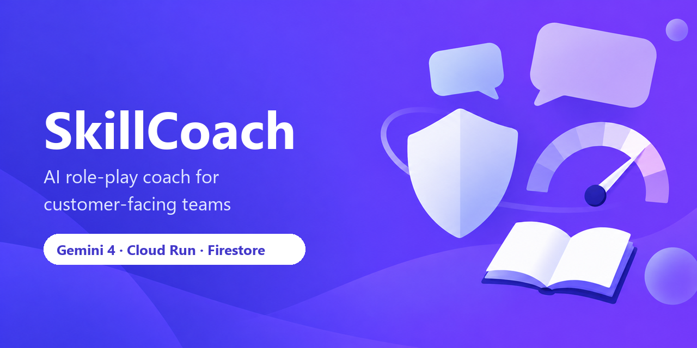

# SkillCoach

**An AI role-play coach that turns your company's own knowledge into realistic, compliance-safe practice conversations, powered by Gemini on Cloud Run.**

> Google Cloud AI Builder Cup 2026 entry, theme: *Future of Work & Enterprise Productivity*

- **Live demo:** https://skillcoach-aibc.web.app (Firebase Hosting in front of the Cloud Run web service; direct Cloud Run URL: https://skillcoach-web-506140624406.asia-east1.run.app)
- **Source code:** https://github.com/jease0502/SkillCoach-AIBC
- **API:** https://skillcoach-api-506140624406.asia-east1.run.app (public, for example `GET /api/scenarios`)
- **Demo video (3 to 4 min):** `TODO: https://youtu.be/<id>`
- **Pitch deck (official AI Builder Cup template):** [media/SkillCoach_Submission.pdf](media/SkillCoach_Submission.pdf) ([.pptx](media/SkillCoach_Submission.pptx); content: [docs/DECK.md](docs/DECK.md))
- **Brief description (submission form):** [docs/SUBMISSION_BRIEF.md](docs/SUBMISSION_BRIEF.md)

---

## Problem

Customer-facing teams (sales, insurance and financial advisors, customer support, retail, clinic front desks) learn their job by talking to customers, and the first real conversations are where the costly mistakes happen.

- **Role-play training doesn't scale.** It depends on senior staff who are scarce, expensive, and busy selling. Most new hires get a handful of practice sessions at best.
- **Onboarding is slow.** Product manuals, policies and codes of conduct sit in PDFs. Reading them is not the same as answering a skeptical customer in real time.
- **Tribal knowledge walks out the door.** How the best rep handles "your competitor is cheaper" lives in that rep's head, not in a system.
- **Compliance mistakes are expensive.** A single "this fund guarantees 8% a year" can mean regulatory fines, refunds, and lost trust.
- **Feedback is vague.** "Be more confident" isn't actionable. Managers have no consistent view of where the team is weak.

## Solution

SkillCoach lets an employee practice a realistic conversation, by text or voice, with a Gemini-powered AI customer that knows **your** products and policies.

1. **Upload knowledge.** An admin uploads product manuals, policies and codes of conduct. SkillCoach chunks and embeds them for retrieval.
2. **Generate and approve personas.** SkillCoach drafts customer personas from the uploaded documents; every generated attribute carries citations to the source passages. A trainer reviews, edits and approves each one (`draft` to `approved`). Only approved personas can back a scenario.
3. **Pick a scenario.** E.g. "Skeptical CFO pushes back on SaaS pricing", "Retiree asks for guaranteed returns", "Angry customer demands a refund outside policy".
4. **Practice.** The customer's opening line is served verbatim from the persona or scenario. After that, the AI customer stays in character, raises realistic objections, and only states facts that are in the company's knowledge base.
5. **Get coached in real time.** When the trainee presses Send, a Compliance Guard pre-check runs first: if it finds a high-severity issue, the message is held back and a card offers **Edit message** or **Send anyway**. A grounding post-check reviews the customer's reply, and a coach agent suggests the next move.
6. **Get an evidence-based report.** Every rubric score quotes the trainee's own words, and the server verifies each quote against the transcript. A dimension with no verified evidence is capped at 50. Any high-severity compliance violation fails the compliance gate (`compliance_passed = false`) and caps the overall score at 59, however good the rest was.
7. **Managers see the gaps.** The dashboard shows aggregates plus session summaries, no transcripts: scores by skill, top violated rules, recent sessions, and a "Ready to go live" count (`Dashboard.ready_count`: ended sessions that passed the compliance gate with an overall score of 80 or more).

## Why this is the Future of Work

| Theme goal | How SkillCoach delivers it |
| --- | --- |
| **Access knowledge** | Company documents become an interactive sparring partner instead of a PDF nobody reads. Every answer is grounded in and cited from the source. |
| **Make better decisions** | Trainees learn the right call (and the compliance line) before they face a real customer. Managers decide where to invest coaching based on aggregated evidence, not gut feel. |
| **Complete everyday work** | Practice is available 24/7, takes 10 minutes, and needs no senior colleague's calendar. |
| **Productivity & efficiency** | Senior staff time moves from repetitive role-play to the coaching that actually needs a human. Target: shorten time-to-first-solo-call for new hires. |
| **Collaboration** | The same transcript, scores and evidence are visible to trainee and manager, so coaching conversations start from shared facts. |

## Key Features

| Feature | Status |
| --- | --- |
| Knowledge upload (PDF / Markdown / text) with chunking and Gemini embeddings | Core |
| Persona generation from documents with citations, and a `draft` to `approved` review step | Core |
| Scenario configuration (goal, hidden concerns, compliance rules and rubric with citations, difficulty) | Core |
| Text role-play with a grounded AI customer (RAG with citations) | Core |
| Compliance Guard on Send: interception with "Edit message" / "Send anyway" for high-severity issues | Core |
| Compliance pre-check and grounding post-check on every turn | Core |
| Compliance gate in the report (high-severity violation fails the session, overall score capped at 59) | Core |
| Real-time coach hints | Core |
| End-of-session rubric report with verified quoted evidence and source citations | Core |
| Manager dashboard: aggregates plus session summaries (no transcripts) and a "Ready to go live" count | Core (basic) |
| Browser voice (Web Speech API): speech-to-text input and spoken customer replies; text mode always available | Shipped |
| Native voice via Gemini Live API (low-latency, interruptible) | Planned |
| Live call mode: the trainee's camera next to the 3D customer, hands-free voice turns (speak, the reply is spoken back, the mic reopens), and per-turn delivery feedback where Gemini 3.5 Flash-Lite reviews one camera frame for eye contact, expression and posture (frames are not stored; Chrome or Edge for voice) | Shipped |
| 3D customer avatar on the practice screen (three.js + three-vrm, VRM 1.0): idle breathing, blinking, eye contact, lip sync while the reply streams or is spoken, facial mood driven by the trust and patience meters; initials fallback without WebGL | Shipped |
| On-device facial emotion cues (MediaPipe, browser only, no video leaves the device) | Planned |

"Planned" items are not part of the judged build unless shown in the demo video.

## How Gemini is used

SkillCoach uses seven Gemini agent roles: builder, precheck judge, persona, grounding, state, coach and report. Each trainee turn runs a short multi-agent pipeline. Every agent is a Gemini call through the `google-genai` SDK on Vertex AI, with structured JSON output (`response_schema`) so the orchestrator never parses free text. Model IDs are environment variables defined in [docs/API_CONTRACT.md](docs/API_CONTRACT.md).

| Agent | Model (default) | What it does | Gemini features used |
| --- | --- | --- | --- |
| **Compliance Guard (precheck judge)** | `gemini-3.5-flash-lite` (`GEMINI_LITE_MODEL`, thinking `low`) | Screens the trainee's message against the scenario's compliance rules (e.g. "no guaranteed returns", "no medical diagnosis"). Runs on Send via `POST /api/sessions/{id}/precheck` (keyword pass + fast Gemini, target under 2 s, nothing stored) so a high-severity issue can be intercepted, and again inside the turn (`compliance_pre`) so the flag is recorded. Returns `ComplianceFlag` items `{rule_id, severity, message, quote}`; a flag whose quote is not in the message is dropped. | Structured output, low temperature |
| **Customer persona agent** | `gemini-4-argon` (`GEMINI_FAST_MODEL`, thinking `low`) | Plays the customer: stays in character, pursues hidden needs, raises objections, and only references product facts retrieved from the knowledge base. The opening line is served verbatim with no model call. | Streaming, system instructions (persona), RAG context, multi-turn history |
| **Compliance post-check (grounding)** | `gemini-3.5-flash-lite` | Checks the customer's reply for product claims that are not supported by the retrieved knowledge, so the AI customer does not teach wrong facts. Runs concurrently with state + coach and emits the `compliance_post` SSE event with `ComplianceFlag` items (`rule_id: "GROUNDING"`). | Structured output, grounding check against retrieved chunks |
| **State** and **coach** (two agents) | `gemini-3.5-flash-lite` | Updates customer trust and patience, and gives one short, actionable hint for the next turn ("Acknowledge the cost concern before pitching ROI"), citing the playbook passage it relies on. | Structured output, RAG over playbooks |
| **Report (scorer)** | `gemini-4-argon` (`GEMINI_PRO_MODEL`; fallbacks `gemini-3.1-pro-preview`, `gemini-2.5-pro`) | At session end, scores each rubric dimension (e.g. discovery, objection handling, accuracy, empathy). Every score must quote the trainee's exact words. | Long context (full transcript + rubric + sources), structured output |
| **Persona / scenario builder** | `gemini-4-argon` (thinking `low`) | Drafts personas and scenarios (compliance rules, rubric) from uploaded documents, with citations to the source passages. Drafts need human approval. Live: 3 personas in 36-40 s, a scenario in 26-30 s, every citation verified. | Structured output, parallel expansion, RAG over uploaded docs |
| **Retrieval** | `gemini-embedding-001` (`GEMINI_EMBED_MODEL`, 768 dims) | Embeds uploaded documents and queries for semantic search; results carry chunk-level citations. | `embed_content` |

Locations (verified on 2026-10-15): Gemini generation runs on the Vertex AI `global` endpoint (`GOOGLE_CLOUD_LOCATION=global`), because the Gemini 3.x models are served only there. Embeddings (`GEMINI_EMBED_LOCATION=asia-east1`), the Cloud Run services and Firestore all run in `asia-east1`; regional embeddings take about 170 ms per query vs about 1.1 s on `us-central1`.

Guardrails, enforced in code rather than trusted to the model:

- **Evidence verification.** Every quoted evidence string is checked against the trainee's turns; quotes that do not match are marked unverified (`Evidence.verified = false`) and are not highlighted as fact. A rubric dimension with no verified evidence is capped at 50.
- **Citation check.** Every cited chunk ID must exist in the knowledge base or the citation is dropped.
- **Compliance gate.** Any high-severity violation sets `Report.compliance_passed = false` and caps `overall_score` at 59.
- **Human approval.** Generated personas start as `draft` and must be approved (`POST /api/personas/{id}/approve`) before a scenario can use them.

## Architecture

```
Firebase Hosting (skillcoach-aibc.web.app) ──rewrite──> Next.js web on Cloud Run (serves the pages)
   │
Browser  ──HTTPS (REST + SSE)──>  FastAPI on Cloud Run  ──>  Vertex AI: Gemini 4 Argon / 3.5 Flash-Lite (global), Embeddings (asia-east1)
   text / voice, 3D avatar         Orchestrator                │
   report, dashboard               ├─ compliance pre-check     │
                                   ├─ customer persona (RAG) ──┤
                                   ├─ compliance post-check (grounding)
                                   ├─ coach                    │
                                   └─ scorer (session end)     │
                                          │
                                   Firestore (asia-east1, database `skillcoach`: sessions, knowledge chunks + vectors)
                                   (in-memory fallback for local dev)
```

Full details, sequence diagrams and data model: [docs/architecture.md](docs/architecture.md). Design decision record: [docs/adr/0001-gemini-on-cloud-run.md](docs/adr/0001-gemini-on-cloud-run.md).

## Quick Start (local)

Prerequisites: Node.js 20+, Python 3.12, a Google Cloud project with Vertex AI enabled, and `gcloud auth application-default login`. Environment variable names and defaults come from [docs/API_CONTRACT.md](docs/API_CONTRACT.md).

```bash
git clone https://github.com/jease0502/SkillCoach-AIBC.git
cd SkillCoach-AIBC

# Backend (settings are read from backend/.env)
cd backend
cat > .env <<'ENV'
GOOGLE_GENAI_USE_VERTEXAI=true
GOOGLE_CLOUD_PROJECT=<your-project-id>
GOOGLE_CLOUD_LOCATION=global
GEMINI_EMBED_LOCATION=asia-east1
GEMINI_FAST_MODEL=gemini-4-argon
GEMINI_LITE_MODEL=gemini-3.5-flash-lite
GEMINI_PRO_MODEL=gemini-4-argon
GEMINI_EMBED_MODEL=gemini-embedding-001
STORE_BACKEND=memory
# FIRESTORE_DATABASE=skillcoach     # only with STORE_BACKEND=firestore; default "(default)"
CORS_ORIGINS=*
ENV
python -m venv .venv && source .venv/bin/activate
pip install -r requirements.txt     # runtime deps + pytest (tests: python -m pytest)
python -m app.seed                  # optional: load demo documents, personas, scenarios
uvicorn app.main:app --reload --port 8080

# Frontend (new terminal)
cd frontend
cp .env.example .env.local    # NEXT_PUBLIC_API_URL=http://localhost:8080
npm install
npm run dev
```

To use an AI Studio key instead of Vertex AI, set `GOOGLE_GENAI_USE_VERTEXAI=false` and `GEMINI_API_KEY`. For offline work, `LLM_FAKE=true` (backend: canned LLM output and hash embeddings) and `NEXT_PUBLIC_MOCK=true` (frontend: local fixtures and a simulated SSE stream) need no Google Cloud access. For credentials, run `gcloud auth application-default login` or set `GOOGLE_APPLICATION_CREDENTIALS` to an ADC file outside the repository; never copy credentials into the repo.

Open http://localhost:3000, choose a demo scenario, and start practicing. Demo knowledge and scenarios are loaded at startup; see [docs/DEMO_SCRIPT.md](docs/DEMO_SCRIPT.md) for lines that reliably trigger each behavior.

## Deploy to Cloud Run and Firebase Hosting

Cloud Run, Firestore and embeddings run in `asia-east1`; Gemini generation is called on the Vertex AI `global` endpoint. Firebase Hosting (site `skillcoach-aibc`, config in [firebase.json](firebase.json)) serves the public URL and rewrites every path to the Cloud Run web service. The scripts require `PROJECT_ID` (there is no default) and run in this order:

```bash
PROJECT_ID=<project-id> FIRESTORE_DATABASE=skillcoach ./infra/gcp-setup.sh   # one-time: APIs, service accounts, Firestore
PROJECT_ID=<project-id> FIRESTORE_DATABASE=skillcoach ./infra/deploy.sh      # API service
PROJECT_ID=<project-id> EXTRA_ORIGINS=https://skillcoach-aibc.web.app,https://skillcoach-aibc.firebaseapp.com \
  ./infra/deploy-web.sh                                                       # web service
PROJECT_ID=<project-id> ./infra/deploy-firebase.sh                            # Firebase Hosting
```

`backend/Dockerfile` (Python 3.12, listens on `$PORT`) is built from source. The web service needs the API URL at build time (`NEXT_PUBLIC_API_URL` is a build argument in `frontend/Dockerfile`); see section 7.2 of [docs/deployment.md](docs/deployment.md) and [frontend/README.md](frontend/README.md). [infra/deploy-firebase.sh](infra/deploy-firebase.sh) uses the Firebase Hosting REST API with your gcloud login and adds the `web.app` / `firebaseapp.com` origins to the API's CORS list. Service accounts, the full environment variable list, Firestore setup and Secret Manager usage are documented in deployment.md, which is authoritative.

## Tech Stack

- **Frontend:** Next.js (React, TypeScript), Tailwind CSS, browser Web Speech API (speech-to-text and `speechSynthesis`), three.js + `@pixiv/three-vrm` (3D customer avatar); planned: Gemini Live API voice, MediaPipe Face Landmarker
- **Backend:** Python, FastAPI, Pydantic
- **AI:** seven Gemini agent roles on `gemini-4-argon` (persona, builder, report) and `gemini-3.5-flash-lite` (precheck, grounding, state, coach), with automatic fallback chains to `gemini-3.8-flash`, `gemini-3.1-pro-preview` and `gemini-2.5-pro`, `gemini-embedding-001` (768 dims), via the `google-genai` SDK on Vertex AI; planned: Gemini Live API
- **Data:** Firestore in `asia-east1`, named database `skillcoach` (sessions, knowledge chunks, vectors); in-memory store for local development
- **Cloud:** Cloud Run, Firebase Hosting, Artifact Registry, Cloud Build, Secret Manager, Cloud Logging

## Roadmap

- **Hackathon build:** text role-play, persona generation with approval, multi-agent pipeline, RAG with citations, evidence-verified report with a compliance gate, basic manager view, browser voice, 3D customer avatar. See [docs/scope-3day.md](docs/scope-3day.md).
- **Next:** Gemini Live API voice with barge-in; on-device emotion cues feeding the coach.
- **Later:** SSO and multi-tenant workspaces; LMS / CRM integrations (export scores, pull real call topics); scenario generation from real (anonymized) call transcripts; multilingual practice for JAPAC markets; certification tracks with pass thresholds.

## Team

| Name | Role | Contact |
| --- | --- | --- |
| `TODO` | `TODO` | `TODO` |
| `TODO` | `TODO` | `TODO` |

## Hackathon docs

- [docs/HACKATHON.md](docs/HACKATHON.md): judging-criteria mapping, video storyboard, deck outline
- [docs/DEMO_SCRIPT.md](docs/DEMO_SCRIPT.md): demo scenario cards
- [docs/SUBMISSION_BRIEF.md](docs/SUBMISSION_BRIEF.md): brief description for the submission form (how we use Firebase, Firestore, Cloud Run and Gemini)
- [SUBMISSION_CHECKLIST.md](SUBMISSION_CHECKLIST.md): pre-submission checklist

## Third-party assets and licences

| Component | Used for | Licence |
| --- | --- | --- |
| [Microsoft Rocketbox](https://github.com/microsoft/Microsoft-Rocketbox) | 7 customer avatar characters, exported to VRM and slimmed to 3-5 MB each by [tools/avatars/slim_vrm.py](tools/avatars/slim_vrm.py); files in `frontend/public/avatars/` | MIT |
| [three.js](https://github.com/mrdoob/three.js) | WebGL rendering of the customer avatar | MIT |
| [@pixiv/three-vrm](https://github.com/pixiv/three-vrm) | VRM 1.0 loading, expressions, look-at and lip sync | MIT |

Attribution details: [NOTICE](NOTICE).

## License

Apache License 2.0 for the project's own code. See [LICENSE](LICENSE). Third-party components keep their own licences (above).
