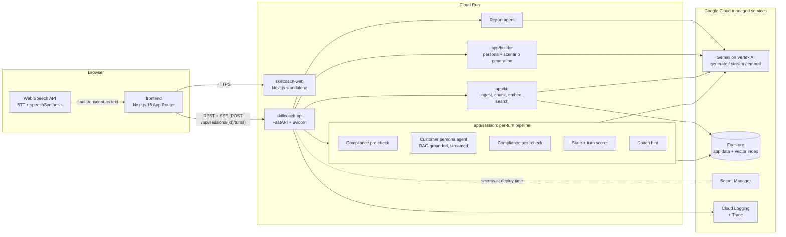
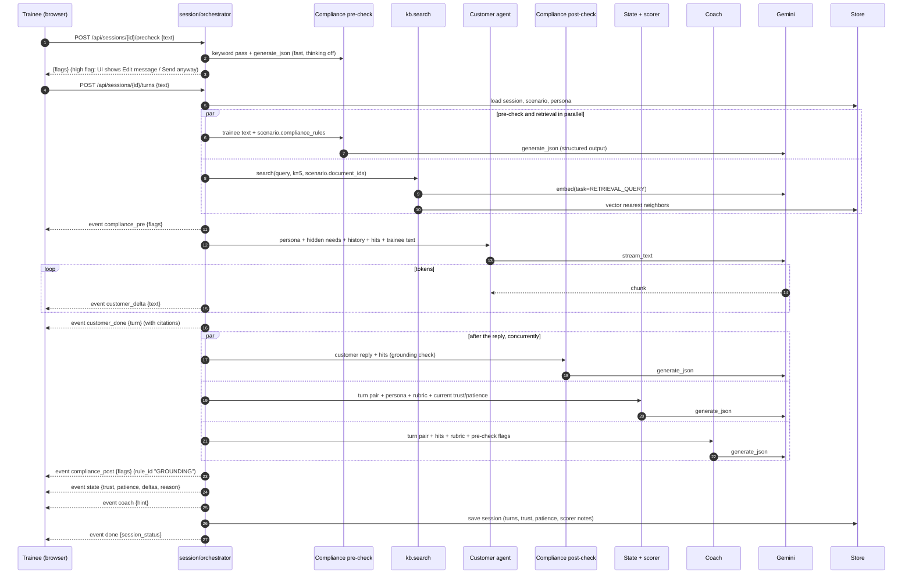
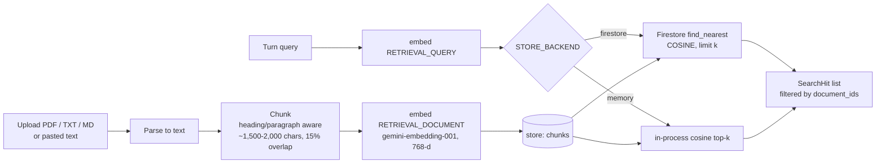

# Architecture

SkillCoach is an AI role-play coach for frontline staff. A company uploads its
knowledge documents (product sheets, policies, scripts). An employee then talks
(text, optionally voice) with a Gemini-powered customer persona. Every turn runs
through a small multi-agent pipeline that keeps the conversation compliant,
grounded in the company's own documents, and coached. When the session ends,
Gemini writes a rubric report that quotes the trainee's own words and cites
the knowledge sources. A manager dashboard aggregates the results.

This document describes the hackathon build (Google Cloud AI Builder Cup 2026,
theme "Future of Work & Enterprise Productivity"). It is deliberately lean:
one API service, one web app, one database, one model family.

- Models: Gemini, through the `google-genai` Python SDK (Vertex AI backend);
  generation on the Vertex AI `global` endpoint; embeddings in `asia-east1`,
  next to Cloud Run and Firestore
- Compute: Cloud Run in `asia-east1` (`skillcoach-api` from `backend/`, `skillcoach-web` from `frontend/`)
- Data: Firestore in `asia-east1` (documents, chunks with vectors, personas, scenarios, sessions, reports)
- Secrets: Secret Manager

**Endpoints, SSE event names, env var names and Pydantic models are defined
in [API_CONTRACT.md](API_CONTRACT.md) and `backend/app/schemas.py`.** This
document explains how the system works behind that contract and does not
redefine it. If the two disagree, the contract wins.

Related: [ADR-0001](adr/0001-gemini-on-cloud-run.md), [deployment](deployment.md),
[3-day scope](scope-3day.md).

---

## 1. System diagram



Design rules the rest of this document depends on:

1. **The browser never talks to Gemini directly.** All model calls go through
   the API, which runs as a service account. No key ever ships to the client.
2. **All Gemini calls go through `backend/app/llm/gemini.py`** (`generate_json`,
   `generate_text`, `stream_text`, `embed`). No module imports `google.genai`
   anywhere else.
3. **Every agent except the streamed customer reply returns JSON matching a
   Pydantic schema** (Gemini structured output). No agent parses another
   agent's free text.
4. **The persona's hidden needs and objection triggers never reach the
   trainee view.** They are used in the server-side prompt only.
5. **Agents are stateless functions.** State lives in the store
   (`STORE_BACKEND=memory|firestore`), so any Cloud Run instance can serve
   any turn when Firestore is used.

---

## 2. Components

| Component | Path | Responsibility |
|---|---|---|
| Web app | `frontend/` | Upload docs, generate/edit personas and scenarios, practice room (chat + optional voice), live coach panel, report view, manager dashboard |
| App factory | `backend/app/main.py`, `config.py` | Routers, CORS (`CORS_ORIGINS`), settings |
| Gemini wrapper | `backend/app/llm/` | The four functions above; retries, timeouts, token logging |
| Store | `backend/app/store/` | `put/get/list/delete` over `memory` or `firestore` |
| Knowledge base | `backend/app/kb/` | Parse, chunk, embed, vector search, citations |
| Builder | `backend/app/builder/` | Gemini-generated personas (from a brief or from docs) and scenarios (goal, compliance rules with citations, rubric, branch events) |
| Practice engine | `backend/app/session/` | Agents, orchestrator, SSE streaming, report, dashboard |
| Seed | `backend/app/seed/` | Demo docs, personas, scenarios |

There is no separate worker, queue, Redis or vector database. Ingestion of a
hackathon-sized corpus runs inline in the upload request and finishes in seconds.

---

## 3. Models

The contract defines three model env vars and two location env vars. The
defaults below were verified against the project
(`project-6d34f8a9-8150-4e6a-ae7`) on 2026-10-15.

| Env var | Default | Used by |
|---|---|---|
| `GEMINI_FAST_MODEL` | `gemini-4-argon` | Customer persona (streamed), persona and scenario builder |
| `GEMINI_LITE_MODEL` | `gemini-3.5-flash-lite` | Per-turn judgments: compliance pre-check, grounding post-check, state, coach |
| `GEMINI_PRO_MODEL` | `gemini-4-argon` | Final report |
| `GEMINI_FAST_FALLBACKS` / `GEMINI_PRO_FALLBACKS` / `GEMINI_LITE_FALLBACKS` | `gemini-3.8-flash` / `gemini-3.1-pro-preview,gemini-2.5-pro` / `gemini-3.8-flash` | Tried in order when a tier's model fails |
| `GEMINI_EMBED_MODEL` | `gemini-embedding-001` (768 dims via `output_dimensionality`) | KB ingest and search |
| `GOOGLE_CLOUD_LOCATION` | `global` | All generation calls |
| `GEMINI_EMBED_LOCATION` | `asia-east1` | Embedding calls |
| (stretch, voice) | `gemini-3.8-live` | Gemini Live API, only if built (not verified) |

Important notes:

- **Locations are split.** `gemini-4-argon`, `gemini-3.8-flash`, `gemini-3.5-flash-lite` and
  `gemini-3.1-pro-preview` return 200 only on `location=global` (404 on
  `us-central1`). `gemini-embedding-001` is regional and is called in
  `asia-east1` (`GEMINI_EMBED_LOCATION`), next to Cloud Run: about 170 ms per
  query vs about 1.1 s cross-Pacific to `us-central1`. The wrapper keeps two clients.
- **Gemini 2.5 is a fallback only.** `gemini-2.5-flash` and `gemini-2.5-pro`
  work on both `global` and `us-central1` in this project. `gemini-2.5-pro`
  is the last fallback in the pro chain.
- **Fallback chains.** Each tier has a fallback chain (`GEMINI_*_FALLBACKS`): fast `gemini-4-argon` → `gemini-3.8-flash`; pro `gemini-4-argon` → `gemini-3.1-pro-preview` → `gemini-2.5-pro`; lite `gemini-3.5-flash-lite` → `gemini-3.8-flash`. On 404/429/5xx, a timeout or invalid JSON the call moves to the next model, and the failed model cools down for 60 s.
- `gemini-3.5-flash-lite` (`GEMINI_LITE_MODEL`) runs the per-turn judgments
  (compliance pre-check, grounding post-check, state, coach) so they finish in
  about a second.
- The persona and scenario builder runs on `gemini-4-argon` with thinking
  `low`. PENDING re-measure on `gemini-4-argon`. Measured on `gemini-3.8-flash` (live, 2026-10-16, nothing saved): 3 personas from documents in 13.5 s, a scenario in 11.4 s, a persona from a brief in 9.1 s, with every returned citation verified against the source text (37 of 37). (On 3.x, Flash had matched `gemini-3.1-pro-preview` at 2-3x the speed, 12.8 s vs 25.3 s for 3 personas.)
- `gemini-embedding-001` returns 3072 dims by default; Firestore vector
  indexes cap at 2048. The `embed()` wrapper always passes
  `output_dimensionality=768` and normalizes the vectors.
  `gemini-embedding-2` is the named successor (switching requires re-ingest).
- Data residency: data at rest (Firestore, Cloud Run, logs) stays in the
  chosen APAC region (`asia-east1`); inference goes through the Vertex AI
  `global` endpoint (embeddings are served in `asia-east1`). Do not describe this
  as "data never leaves Taiwan".
- Emergency fallback: `GOOGLE_GENAI_USE_VERTEXAI=false` plus `GEMINI_API_KEY`
  (from Secret Manager) switches the same SDK to the Gemini Developer API with
  no code change.

Wrapper sketch (`backend/app/llm/gemini.py`):

```python
from google import genai
from google.genai import types

client = genai.Client()   # reads GOOGLE_GENAI_USE_VERTEXAI / PROJECT / LOCATION (global); ADC on Cloud Run
embed_client = genai.Client(vertexai=True, project=settings.GOOGLE_CLOUD_PROJECT,
                            location=settings.GEMINI_EMBED_LOCATION)   # asia-east1

async def generate_json(prompt, schema, *, system=None, model=None, temperature=0.4):
    resp = await client.aio.models.generate_content(
        model=model or settings.GEMINI_FAST_MODEL,
        contents=prompt,
        config=types.GenerateContentConfig(
            system_instruction=system,
            response_mime_type="application/json",
            response_schema=schema,          # Pydantic class from app/schemas.py or agent-local
            temperature=temperature,
        ),
    )
    return resp.parsed

async def stream_text(prompt, *, system=None, model=None):
    stream = await client.aio.models.generate_content_stream(
        model=model or settings.GEMINI_FAST_MODEL, contents=prompt,
        config=types.GenerateContentConfig(system_instruction=system, temperature=0.8))
    async for chunk in stream:
        if chunk.text:
            yield chunk.text

async def embed(texts, *, task="RETRIEVAL_DOCUMENT"):
    resp = await embed_client.aio.models.embed_content(
        model=settings.GEMINI_EMBED_MODEL, contents=texts,
        config=types.EmbedContentConfig(task_type=task, output_dimensionality=768))
    return [normalize(e.values) for e in resp.embeddings]
```

---

## 4. Per-turn request flow

A turn starts with an optional interception step and then one
`POST /api/sessions/{id}/turns` call whose response is an SSE stream. Event
names and payloads are in the contract (`compliance_pre`, `customer_delta`,
`customer_done`, `compliance_post`, `state`, `coach`, `done`, `error`). The
diagram shows which agent produces which event.

**Compliance Guard on Send (interception).** When the trainee presses Send,
the frontend first calls `POST /api/sessions/{id}/precheck {text}` (keyword
pass + fast Gemini with thinking off, target under 2 s, nothing stored). If
any `high` flag comes back, the UI holds the message and shows the
Compliance Guard card with **Edit message** / **Send anyway**. Edit returns
the text to the input; Send anyway (or no high flag, or a pre-check timeout
over 2.5 s) proceeds to the turn call below.



Notes:

- The customer's first turn is not part of this flow. `POST /api/sessions`
  returns the `Session` with the opening turn already in it, served
  verbatim from `Scenario.opening_line` (when set) or `Persona.opening_line`,
  with no model call. This keeps demo openings deterministic.
- `customer_done` is sent as soon as the reply has streamed, with its
  `citations`. The grounding post-check runs concurrently with state and
  coach and reports through `compliance_post` (`ComplianceFlag` items with
  `rule_id: "GROUNDING"`); it flags the reply, it does not rewrite it.
- Interception happens only in the `/precheck` step before the turn. Once
  the trainee sends (including "Send anyway"), `compliance_pre` flags never
  stop the customer from replying. They are attached to the trainee's
  `Turn.compliance`, shown in the UI, fed to the coach, and counted in the
  report, where a high flag fails the compliance gate.
- The session ends (`done.session_status = "ended"`) when the state agent
  says the customer has left (patience 0) or agreed, or `scenario.max_turns`
  is reached.

Latency targets (text mode): first `customer_delta` within about 1.5 s,
`done` within about 4 s. Measured on live with `gemini-3.8-flash` (2026-10-16; PENDING re-measure on `gemini-4-argon`): first
token 1.7-2.0 s and `done` in 3.3-3.6 s (5.5 s / 6.8 s on a turn with a compliance violation),
retrieval 0.17-0.24 s, pre-check 0.8-1.3 s, report 9.9 s (about 3 s when drafted speculatively). Every agent call has a timeout (about 8 s). If a
non-critical agent (post-check, scorer, coach) times out or returns an
invalid schema, the orchestrator skips it, logs it, and the turn still
completes. Only the customer agent is on the critical path; if it fails,
an `error` event is sent.

---

## 5. Agent definitions

Agents live in `backend/app/session/agents/`. Output types are the shared
models from `backend/app/schemas.py` where one exists, otherwise a small
agent-local Pydantic model (internal, not part of the API).

| Agent | Model env var | Gemini features | Output |
|---|---|---|---|
| Compliance pre-check | `GEMINI_LITE_MODEL`, temp 0, thinking low | structured output | `list[ComplianceFlag]` |
| Customer persona | `GEMINI_FAST_MODEL`, temp 0.8 | streaming; RAG context in prompt; system instruction | streamed text, then `Turn` with `citations` |
| Compliance post-check (grounding) | `GEMINI_LITE_MODEL`, temp 0, thinking low | structured output | `list[ComplianceFlag]` (`rule_id: "GROUNDING"`) -> `compliance_post` event |
| State + turn scorer | `GEMINI_LITE_MODEL`, temp 0.2, thinking low | structured output | `StateUpdate` (internal) -> `state` event |
| Coach | `GEMINI_LITE_MODEL`, temp 0.4, thinking low | structured output | `CoachHint` |
| Report | `GEMINI_PRO_MODEL`, temp 0.2 | long context, structured output | `Report` |
| Persona / scenario builder | `GEMINI_FAST_MODEL`, thinking low | structured output, RAG over uploaded docs, parallel expansion | `Persona`, `Scenario` drafts |

### 5.1 Compliance pre-check

- **Role:** check the trainee's message against `scenario.compliance_rules`
  (for example: no guaranteed returns, no fee waivers without approval,
  disclose the cooling-off period). Also flags obvious PII and prompt
  injection ("ignore your instructions").
- **Input:** trainee text, compliance rules (each with `id`, `rule`,
  `severity`, and citations to the source policy), last 2 turns.
- **Output:** `ComplianceFlag[]`, each with `rule_id`, `severity`, `message`
  and `quote` (the exact offending words). The orchestrator drops any flag
  whose `quote` is not a substring of the trainee text.
- A keyword/regex pass runs first, with no model call.
- The same check backs `POST /api/sessions/{id}/precheck` (interception on
  Send, fast model with thinking off, target under 2 s, nothing stored) and
  the `compliance_pre` event inside the turn (recorded on the turn).

### 5.2 Customer persona agent (RAG grounded)

- **Role:** play the `Persona`. Stay in character, pursue `goals`, keep
  `hidden_needs` secret until the trainee earns trust, raise `objections`
  when their `trigger` fires, apply any `branch_events` whose trigger matches
  (for example "turn >= 4", "trust < 30").
- **Input (prompt):** persona profile, current `trust` and `patience`,
  scenario context, last 8 turns, top-k `SearchHit`s rendered with chunk IDs:

  ```text
  <knowledge>
  [c:3f9a] (Product Guide) Withdrawing before 12 months incurs a 1.5% fee...
  </knowledge>
  ```

  The customer is instructed to react with doubt when the trainee states
  something that contradicts the knowledge, and never to quote the knowledge
  verbatim itself (customers do not read the manual aloud).
- **Output:** streamed text via `stream_text`. After streaming, the
  orchestrator builds `Turn(role="customer", citations=...)` from the
  retrieved hits.

### 5.3 Compliance post-check

- **Role:** grounding check of the customer reply: product claims (prices,
  fees, guarantees, coverage) that are not supported by the retrieved
  knowledge are flagged, so the AI customer does not teach wrong facts.
- **Runs:** concurrently with state + coach, after `customer_done`.
- **Output:** `ComplianceFlag[]` with `rule_id: "GROUNDING"`, `severity`,
  `message` and the exact `quote` from the reply, sent as the
  `compliance_post` SSE event.

### 5.4 State + turn scorer

- **Role:** update the customer's `trust` and `patience` (0-100) and leave
  per-turn rubric notes for the final report. This is the "scorer" in the
  pipeline; the authoritative score is the end-of-session report.
- **Output (internal):**

  ```json
  { "trust": 55, "patience": 62,
    "ended": false, "end_reason": "",
    "rubric_notes": [{ "rubric_id": "discovery", "signal": "positive | negative",
                       "quote": "string", "note": "string" }] }
  ```

  The orchestrator clamps trust/patience changes to at most +/-20 per turn so
  the meters move believably, emits `state`, and stores `rubric_notes` on the
  session for the report agent.

### 5.5 Coach

- **Role:** one short, actionable whisper for the next turn, linked to a
  rubric item or compliance rule and, when possible, to a knowledge source.
- **Output:** `CoachHint { hint, technique, citations[] }`, hint at most about
  25 words. Example: "She mentioned her kids twice; ask about education
  goals before pitching (technique: discovery)."

### 5.6 Report agent (end of session)

- **Trigger:** `POST /api/sessions/{id}/end`.
- **Input:** full transcript, all compliance flags, stored `rubric_notes`,
  scenario rubric and success criteria, all chunks retrieved during the
  session (deduplicated).
- **Output:** `Report`: `overall_score`, `summary`, per-rubric
  `DimensionScore` with `evidence[]` (turn index + verbatim quote),
  `compliance_violations`, `strengths`, `improvements`,
  `knowledge_citations`.
- **Verification (cheap, decisive):** after generation, every
  `Evidence.quote` is checked against the trainee turns (the turn at
  `turn_index` first); `verified` is set accordingly and the UI only
  highlights verified quotes. Every `Citation.chunk_id` must exist in the
  store or it is dropped. This makes the "quotes your own words, cites your
  own documents" claim true by construction, which is a strong Technical
  Merit talking point.
- **Evidence cap:** a `DimensionScore` with no verified evidence is capped
  at 50 and its feedback says so. A rubric item the model did not assess
  scores 0 ("Not assessed").
- **Compliance gate:** if any trainee turn carries a high-severity
  `ComplianceFlag`, `Report.compliance_passed` is `false` and
  `overall_score` is capped at 59, however good the other dimensions are.
  The gate is what certification ("Ready to go live") is based on.

### 5.7 Builder (persona and scenario generation)

- `POST /api/personas/generate-from-docs`: Gemini reads a sample of chunks
  (`kb.get_chunks`) and drafts 3 realistic customer personas with hidden
  needs and objections tied to the documents. Each draft carries
  `Persona.citations` to the passages its attributes are derived from.
- `POST /api/scenarios/generate`: drafts the trainee goal, compliance rules
  and rubric items, each with `Citation`s back to policy chunks
  (`ComplianceRule.citations`, `RubricItem.citations`), and branch events.
- Both use `generate_json` with `GEMINI_PRO_MODEL` and the shared schemas
  directly as `response_schema`. Drafts are returned unsaved so the manager
  can edit before saving.
- **Approval:** saved personas start with `status = "draft"`. A trainer
  approves one with `POST /api/personas/{id}/approve`. Only approved
  personas can back a scenario; generating or saving a scenario for a draft
  persona returns `409`.

### 5.8 Dashboard

`GET /api/dashboard` returns aggregates plus session summaries, no
transcripts: session count, average score, `ready_count`, average per
rubric dimension, top violated rules, and recent session summary rows
(scenario, persona, score, `compliance_passed`). `ready_count` is computed
by the backend: ended sessions with `compliance_passed` and
`overall_score >= 80`; the UI shows it as "Ready to go live".

---

## 6. RAG design



- **Parsing:** `pypdf` for PDF, raw text for TXT/MD, and the
  `/api/kb/documents/text` endpoint for pasted text. Scanned PDFs are out
  of scope.
- **Chunking:** split on headings and blank lines, pack to about 1,500-2,000
  characters with 15 percent overlap. Store `document_id` and `index`
  (see `Chunk`); the document title is joined at search time for
  `SearchHit.document_title`.
- **Embedding:** batched `embed()` calls (up to 100 texts per call), task
  type `RETRIEVAL_DOCUMENT` at ingest and `RETRIEVAL_QUERY` at search.
  The query for a turn is the trainee text plus the scenario context line.
- **Firestore backend:** each chunk document has an `embedding` field of
  type `Vector(768)`. One flat vector index on collection `chunks` (see
  [deployment](deployment.md)). Query:

  ```python
  from google.cloud.firestore_v1.vector import Vector
  from google.cloud.firestore_v1.base_vector_query import DistanceMeasure

  q = db.collection("chunks").find_nearest(
      vector_field="embedding", query_vector=Vector(qvec),
      distance_measure=DistanceMeasure.COSINE, limit=k * 2,
      distance_result_field="distance")
  ```

  `document_ids` filtering is applied after the query (over-fetch `2k`)
  to avoid needing a composite pre-filter index. Fine at demo scale.
- **Memory backend (fallback):** all chunk vectors held in process, cosine
  top-k in plain Python. Used for local dev, tests, the Firestore emulator (which
  has no vector search), and as a safety net if the index is still building.
  Same `search()` signature, so callers never know which backend runs.
- **Score threshold:** hits below a similarity cut-off are dropped. If nothing
  passes, agents receive `<knowledge>NONE</knowledge>` and are told not to
  invent facts; the coach may say "check the product guide" instead.

---

## 7. Data model

Collections (from the contract): `documents`, `chunks`, `personas`,
`scenarios`, `sessions`, `reports`. Document shapes are the Pydantic models
in `backend/app/schemas.py`, plus a few storage-only fields:

| Collection | Model | Storage-only fields |
|---|---|---|
| `documents` | `Document` | none (raw file is not kept; text is in chunks) |
| `chunks` | `Chunk` | `embedding: Vector(768)` (Firestore) or a float list (memory) |
| `personas` | `Persona` | none |
| `scenarios` | `Scenario` | none |
| `sessions` | `Session` (turns embedded) | `rubric_notes[]`, `retrieved_chunk_ids[]` |
| `reports` | `Report` (id = session id) | none |

Rationale for embedding turns in the session document: one read loads the
whole conversation for the next turn, and a 12-turn session stays far under
Firestore's 1 MiB document limit.

The single-tenant demo has no tenant or auth collections. Multi-tenancy
would become a top-level `tenants/{id}` prefix; it is listed as Won't for
the hackathon.

---

## 8. Real-time transport

**Text turns: SSE on a POST response** (`POST /api/sessions/{id}/turns`,
`text/event-stream`, FastAPI `StreamingResponse`).

- One short request per turn, so no long-lived connection, no session
  affinity, and instance restarts or autoscaling are harmless.
- Cloud Run request timeout: the default 300 s is plenty (a turn takes
  about 5 s; the report call about 20-30 s).
- Send `Cache-Control: no-cache` and `X-Accel-Buffering: no`, flush an
  initial `: ok` comment, and do not wrap the route in gzip middleware,
  or the events may arrive in one batch.
- Browser `EventSource` only supports GET, so the frontend reads the POST
  response with `fetch()` and a `ReadableStream` reader, splitting on blank
  lines.

**If Gemini Live voice is built (stretch):** it needs a WebSocket proxy on the
API. On Cloud Run a WebSocket is one long request: raise `--timeout` (max
3600 s), add `--session-affinity` (best-effort only, so the client must
reconnect and the server must reload state from the store), and do not
enable end-to-end HTTP/2 on that service.

---

## 9. Voice

**MVP: browser Web Speech API.** The practice room has a mic button.
`SpeechRecognition` (Chrome/Edge) produces the final transcript, which is
sent as normal text to the same turn endpoint, so all agents run unchanged.
The customer reply is spoken with `speechSynthesis`, choosing a voice by
`persona.locale` and `persona.voice`. No backend change, about two hours of
frontend work.

**Stretch: Gemini Live API** (`gemini-3.8-live`, native audio in and out).
The backend opens `client.aio.live.connect(model=..., config=LiveConnectConfig(
response_modalities=["AUDIO"], system_instruction=persona_prompt,
input_audio_transcription=..., output_audio_transcription=...))` and proxies
PCM audio over a WebSocket. Compliance, scorer and coach run asynchronously
on the transcripts. The browser never connects to Gemini directly (that
would need a client-side credential). Build this only after the text demo
is deployed and recorded.

---

## 10. Security

- **Data location.** Firestore, Cloud Run and logs live in `asia-east1`;
  Gemini generation runs through the Vertex AI `global` endpoint;
  embeddings are served in `asia-east1`. Vertex AI does not use customer data to
  train foundation models.
- **No keys in the client.** On Cloud Run the API authenticates to Vertex AI
  and Firestore with its service account (ADC). There is no Gemini key in
  the frontend bundle or the backend image. `NEXT_PUBLIC_API_URL` is a URL,
  not a secret.
- **Secret Manager** holds only the optional `GEMINI_API_KEY` fallback,
  mounted with `--set-secrets`. Nothing secret is committed or baked into images.
- **Least-privilege service account** for the API: `roles/aiplatform.user`,
  `roles/datastore.user`, `roles/logging.logWriter`, `roles/cloudtrace.agent`,
  and `roles/secretmanager.secretAccessor` on the one secret only.
- **CORS:** the contract default `CORS_ORIGINS=*` is for local development;
  the deployed API sets it to the web service URL.
- **Uploads:** 10 MB limit, extension/MIME allow-list (pdf, txt, md).
- **Prompt injection:** document text and trainee text are wrapped in
  delimited blocks; the system instruction says to treat them as data. The
  pre-check flags injection attempts.
- **Hidden persona data:** used only in server-side prompts, and revealed
  by the persona only once trust is high enough.
- **Auth:** the demo is single-tenant and unauthenticated (labeled "demo
  mode" in the UI). Firebase Authentication is the production next step.

---

## 11. Observability

- **Structured logs:** one JSON line per Gemini call written by the
  `llm/` wrapper: `session_id`, `agent`, `model`, `latency_ms`,
  `input_tokens`, `output_tokens` (from `usage_metadata`), `status`
  (`ok | timeout | schema_error | fallback`). Cloud Run ships stdout to
  Cloud Logging; include the `logging.googleapis.com/trace` field so lines
  group per request.
- **Tracing (Should):** OpenTelemetry FastAPI instrumentation with the
  Cloud Trace exporter; one span per agent call. A trace screenshot showing
  the parallel agent legs is a good deck slide.
- **Health:** `GET /healthz` (contract). A startup self-test that pings each
  configured model ID and logs which ones respond saves debugging time on
  deploy day.
- **Errors:** Cloud Error Reporting picks up stack traces from the logs automatically.
